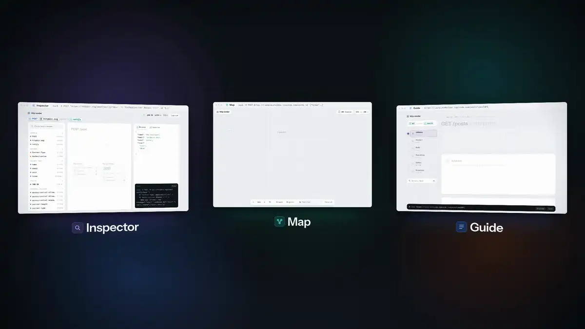
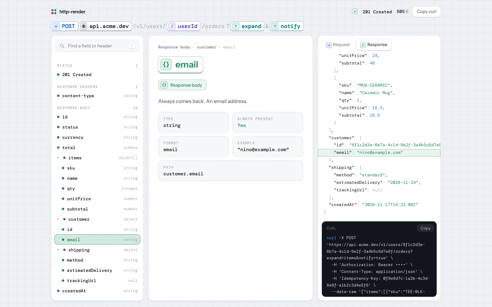
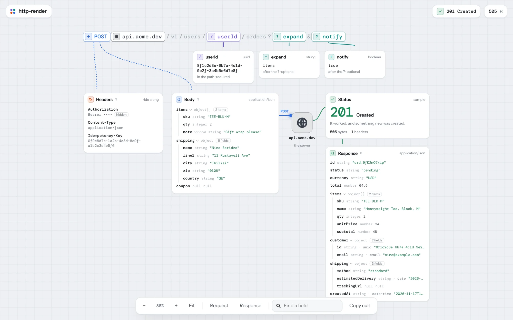
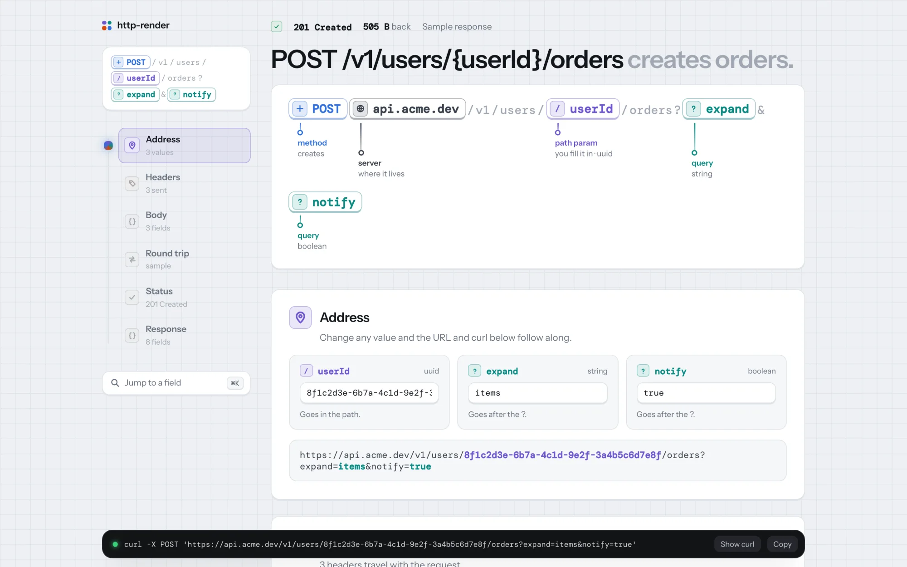
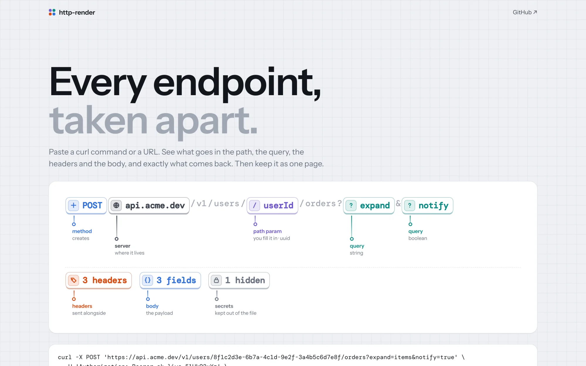

<p align="center">
  <picture>
    <source srcset="assets/logo-dark.svg" media="(prefers-color-scheme: dark)">
    <source srcset="assets/logo-light.svg" media="(prefers-color-scheme: light)">
    
  </picture>
</p>
<h3 align="center">Every endpoint,<br>taken apart</h3>
<p align="center">Give it a curl command or a URL. Get one interactive page that shows<br>what goes in the path, the query, the headers and the body, and exactly what comes back.</p>
<p align="center">
  <a href="https://www.npmjs.com/package/http-render"></a>
  <a href="LICENSE"></a>
  
</p>



## Try it

```sh
npx http-render 'curl -X POST https://api.example.com/v1/users/42/orders -H "Authorization: Bearer …" --json "{\"qty\":2}"'
# ✓ POST /v1/users/{userId}/orders · 201 Created · 84 ms → post-v1-users-userid-orders.html
```

A plain URL works too, and so does whatever your browser copies with **Copy as cURL**:

```sh
npx http-render https://api.github.com/repos/vercel-labs/json-render --open
pbpaste | npx http-render --style map
```

The result is one HTML file with no dependencies. Send it to your team, attach it to a ticket, or open it offline. Tokens, cookies and passwords are replaced with `••••` before anything is written.

## Three styles

### Inspector

For looking things up. An outline of everything on the left, a card for whatever you pick, and the JSON and curl beside it. Pick a field anywhere and it lights up everywhere.

<picture>
  <source srcset="assets/inspector-dark.webp" media="(prefers-color-scheme: dark)">
  
</picture>

### Map

For seeing the whole shape at once. The endpoint drawn as one diagram: the URL's parts, what you send, the server, and what comes back. Pan it, zoom it, search it.

<picture>
  <source srcset="assets/map-dark.webp" media="(prefers-color-scheme: dark)">
  
</picture>

### Guide

For reading top to bottom. One page with a mini-map that follows you. Change a value and the URL and curl update.

<picture>
  <source srcset="assets/guide-dark.webp" media="(prefers-color-scheme: dark)">
  
</picture>

```sh
npx http-render 'curl …' --style inspector   # the default
npx http-render 'curl …' --style map --mode dark
npx http-render 'curl …' --style guide
```

## How it works

1. **Parse.** The curl command is read the way a shell reads it, including what Chrome's and Firefox's "Copy as cURL" produce. Paths like `/users/42` become `/users/{userId}`.
2. **Send.** `GET` requests are sent right away. Anything else asks first, or needs `--yes`. Use `-n` to document the request without sending it, or `-r response.json` to use a response you already have.
3. **Read the shapes.** Every body becomes typed fields: strings, numbers, nested objects and lists, plus formats like uuid, email and dates. Fields missing from some list items are marked optional.
4. **Hide secrets.** Tokens, cookies, API keys and passwords become `••••`, even when the response echoes them back. `--no-redact` keeps them.
5. **Render.** Everything goes into the style you picked, as one page.

## Try it in the browser

The website does the same without installing anything: paste a curl command, watch it come apart, switch styles, then download the page or copy the matching CLI command.

<picture>
  <source srcset="assets/website-dark.webp" media="(prefers-color-scheme: dark)">
  
</picture>

Documents render in your browser. **Send for real** goes through a small relay that only reaches public addresses, checks every redirect, stops after 15 seconds and keeps the first 1 MB. Nothing is stored.

## CLI

```
http-render <curl command | URL> [options]
pbpaste | http-render [options]

  -o, --out <file>       Output file, "-" for stdout
  -f, --format <fmt>     html | json
  -t, --style <name>     inspector | map | guide
  -m, --mode <mode>      auto | light | dark
  -c, --config <file>    Config file (default: ./http-render.config.json)
  -s, --set <key=value>  Override a config value, e.g. --set colors.body=#2f6fde
  -n, --no-exec          Don't send the request
  -r, --response <file>  Use this response body instead of sending
  -y, --yes              Send non-GET requests without asking
      --no-redact        Keep secrets in the output
      --open             Open the result when done
```

Settings can live in `http-render.config.json`:

```json
{
  "style": "guide",
  "mode": "dark",
  "colors": { "body": "#2f6fde", "path": "#6e56cf" },
  "fonts": { "sans": "Inter, sans-serif" },
  "motion": false
}
```

## Library

```ts
import { renderEndpoint, generate, render } from "http-render";

const { doc, html } = await renderEndpoint("https://api.github.com/zen", { execute: true, config: { style: "map" } });

// Or step by step: build the data, then render it however you like.
const endpoint = await generate("curl https://api.example.com/v1/items -H 'Accept: application/json'");
const page = render(endpoint, { style: "inspector", mode: "dark" });
```

`doc` is plain JSON (`EndpointDoc`), so you can store it, diff it, or render it again later in another style.

## Host the website

From the repo root, on Cloudflare Workers:

```sh
pnpm install && pnpm build
npx wrangler deploy
```

Or with Node or Docker:

```sh
node apps/web/dist-server/server.js     # the site and the relay on $PORT (8080)
docker build -t http-render-site . && docker run -p 8080:8080 http-render-site
```

## Contributing

[Contributing](CONTRIBUTING.md) covers the setup, checks and where things live. Report security problems privately, as the [security policy](SECURITY.md) explains.

## License

[MIT](LICENSE)
